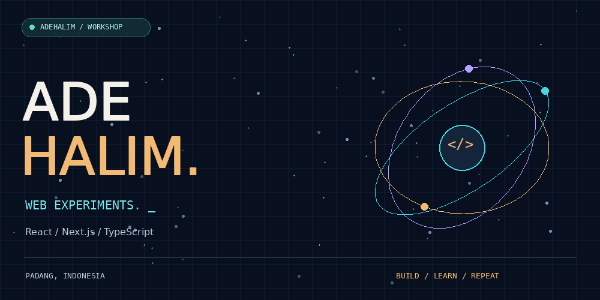
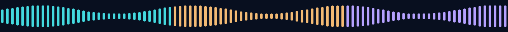

  

<strong>WEB EXPERIMENTS &nbsp; × &nbsp; ARABIC LEARNING &nbsp; × &nbsp; CREATIVE PLAY</strong>

<a href="https://adehalimalfajri.vercel.app">Visit my portfolio</a> &nbsp; ◇ &nbsp; <a href="mailto:adehalim815@gmail.com">Say hello</a> &nbsp; ◇ &nbsp; <a href="https://twitter.com/Aadehalim_">Find me on X</a>

 

## Inside the workshop

I'm **Ade Halim Alfajri**, an Arabic language education student in Padang, Indonesia. I build personal sites, play with interfaces, and turn Arabic vocabulary into things you can click, match, and explore.

Some projects start with a lesson. Others start with “what if I tried this?” This is where those experiments live.

### The toolkit

 

## On the workbench

### 01 / Kalam Playground &nbsp; · &nbsp; كَلَام

**Arabic vocabulary, made interactive.**

Word matching, letter exercises, and interactive reading. A learning playground that brings together my studies and my interest in building for the web.

`React` `TypeScript` `Vite` &nbsp; · &nbsp; [Explore the project →](https://github.com/adehalim/kalam-Playground)

 

### 02 / Portofolio

**A personal corner of the web.**

My portfolio project built with Next.js and TypeScript. An ongoing place to experiment with layouts, interactions, and how I present my work.

`Next.js` `TypeScript` &nbsp; · &nbsp; [View the repository →](https://github.com/adehalim/Portofolio) &nbsp; · &nbsp; [Visit portfolio →](https://adehalimalfajri.vercel.app)

 

### 03 / The rest of the experiments

Smaller projects, learning exercises, and ideas that don't need a grand introduction.

[Open the repository shelf →](https://github.com/adehalim?tab=repositories)

 

<h3>Have something interesting in mind?</h3>

<a href="mailto:adehalim815@gmail.com">Let's talk</a>

FROM PADANG, WITH CURIOSITY. &nbsp; / &nbsp; ADEHALIM

